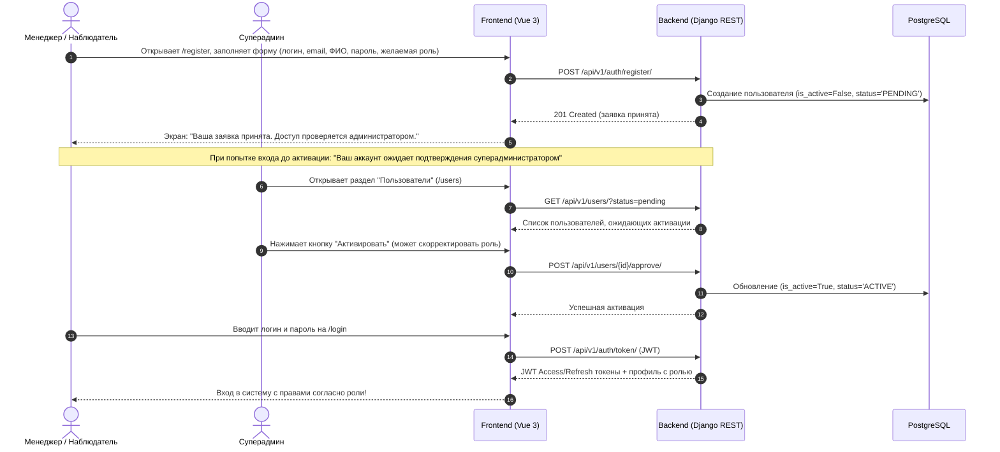
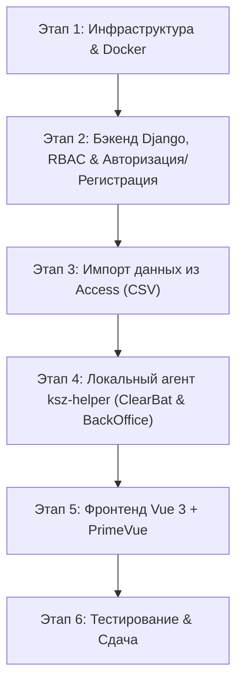

# Архитектура и план реализации проекта KSZ-DB

## 1. Введение и цели проекта

Проект представляет собой перенос клиентской базы данных и инструмента технической поддержки интегратора **iiko** из **MS Access** в современную веб-архитектуру на базе стека **Django + PostgreSQL + Vue 3 (PrimeVue) + Docker Compose**.

### Основные цели
1. Централизация базы данных и отказ от привязки к локальному файлу MS Access / файловым хранилищам.
2. Поддержка строгой ролевой модели пользователей с пре-модерацией регистрации.
3. Сохранение и улучшение высокой операционной скорости работы инженеров:
   - Быстрый поиск клиентов и подключений AnyDesk.
   - Копирование критических данных (UID, CRM ID, сервер, логин, пароль) в один клик.
   - Быстрый запуск AnyDesk и переходов в веб-офисы (iikoWeb, Resto, ЛК iiko).
   - Запуск iikoBackOffice через утилиту `ClearBat` и прямая запись в локальный `Entities.sqlite` с помощью локального агента `ksz-helper`.
   - Встроенный клиентский OCR (распознавание AnyDesk ID из скриншота или буфера обмена без нагрузки на бэкенд).
   - Встроенный генератор надежных паролей.

---

## 2. Стек технологий

| Компонент | Технология / Библиотека | Назначение |
| :--- | :--- | :--- |
| **Backend** | Python 3.12, Django 5.x, Django REST Framework | Бизнес-логика, REST API, ORM, администрирование |
| **База данных** | PostgreSQL 16 | Основное реляционное хранилище данных |
| **Кэш / Очереди** | Redis 7 | Кэширование запросов, сессии, опционально фоновые задачи |
| **Frontend** | Vue 3 (Composition API, `<script setup>`), Vite | Клиентское одностраничное приложение (SPA) |
| **UI Kit** | PrimeVue 4 + PrimeIcons + Tailwind CSS | Информационно-насыщенные таблицы, фильтры, модальные окна, уведомления |
| **State / Routing** | Pinia, Vue Router | Управление состоянием и навигация с защитой маршрутов |
| **OCR** | Tesseract.js (на стороне клиента) | Распознавание 9–10 значных AnyDesk ID из скриншотов/буфера обмена |
| **Контейнеризация** | Docker, Docker Compose, Nginx (Reverse Proxy) | Изоляция окружения, деплой одной командой |
| **Local Companion** | Python (микро-сервис `ksz-helper` на `127.0.0.1:48123`) | Запуск iikoBackOffice через ClearBat и прямая запись в локальный SQLite |

---

## 3. Ролевая модель, Регистрация и Модерация доступа

### 3.1. Роли пользователей (RBAC)

| Роль | Назначение | Права доступа |
| :--- | :--- | :--- |
| **SUPERADMIN** | Полное администрирование системы | Управление пользователями, активация заявок на регистрацию, смена ролей, журнал аудита, полный CRUD клиентов и AnyDesk, экспорт/импорт данных. |
| **MANAGER** | Инженер поддержки / Оператор | Создание клиентов, редактирование заведений, добавление/удаление AnyDesk станций, генерация паролей, чтение и копирование учетных данных, запуск утилит. |
| **VIEWER** | Наблюдатель / Аудитор (Админ только для чтения) | Просмотр списка клиентов и AnyDesk станций, фильтрация и поиск, копирование логинов/паролей/серверов в буфер, открытие ссылок (iikoWeb, Resto, AnyDesk, запуск ClearBat). **Запрещено:** создание, редактирование, удаление любых записей. |

### 3.2. Процесс регистрации и активации (Self-Registration & Approval)



---

## 4. Схема базы данных (PostgreSQL)

```
┌──────────────────────────────────────┐           ┌─────────────────────────────────┐
│               users                  │           │        anydesk_stations         │
├──────────────────────────────────────┤           ├─────────────────────────────────┤
│ id (PK, int)                         │           │ id (PK, int)                    │
│ username (varchar, unique)           │           │ company_id (FK -> companies.id) │
│ email (varchar, unique)              │           │ description (varchar)           │
│ full_name (varchar)                  │           │ anydesk_id (varchar)            │
│ role (SUPERADMIN / MANAGER / VIEWER) │           │ any_pass (varchar)              │
│ is_active (boolean: False по умолч.) │           │ created_at (timestamp)          │
│ registration_status (PENDING/ACTIVE) │           │ updated_at (timestamp)          │
│ date_joined (timestamp)              │           └─────────────────────────────────┘
└──────────────────┬───────────────────┘
                   │ 1
                   │
                   │ N
┌──────────────────▼───────────────────┐           ┌─────────────────────────────────┐
│              companies               │           │       iiko_distributions        │
├──────────────────────────────────────┤           ├─────────────────────────────────┤
│ id (PK, int)                         │           │ id (PK, int)                    │
│ software_type (IIKO / ROSTA)         │           │ iiko_version (varchar)          │
│ node_type (CHAIN / RMS)              │           │ type (varchar: RMS/Chain)       │
│ parent_chain_id (FK -> self)         │           │ link_ya (text)                  │
│ place_name (varchar)                 │           │ created_at (timestamp)          │
│ company_name (varchar)               │           └─────────────────────────────────┘
│ cabinet_name (varchar)               │
│ crm_id (varchar, indexed)            │           ┌─────────────────────────────────┐
│ uid (varchar, indexed)               │           │      Справочники (Directories)   │
│ system_admin_name (varchar)          │           ├─────────────────────────────────┤
│ system_admin_password_enc (text)     │           │ cities (id, name, created_at)   │
│ business_type (varchar)              │           │ business_types (id, name, cr.)  │
│ licence_type (varchar)               │           │ licence_types (id, name, cr.)   │
│ iiko_version (varchar)               │           └─────────────────────────────────┘
│ server_name (varchar)                │
│ port_number (varchar)                │
│ image_link (text)                    │
│ no_ip (varchar)                      │
│ iiko_rosta (varchar)                 │
│ sort_number (int)                    │
│ helpdesk_its (varchar)               │
│ city (varchar, indexed)              │
│ status (boolean: active)             │
│ iiko_web_address (text)              │
│ created_at (timestamp)               │
│ updated_at (timestamp)               │
└──────────────────────────────────────┘
```

### Безопасность паролей:
- На уровне БД пароли заведений и AnyDesk зашифрованы симметричным алгоритмом **AES-256 (Fernet)** с секретным мастер-ключом в `.env`.
- При выгрузке дампа базы данных или компрометации SQL пароли защищены.
- Для авторизованных инженеров в веб-интерфейсе пароль расшифровывается на лету для копирования в 1 клик.

---

## 5. Запуск iikoBackOffice и интеграция с ClearBat

### 5.1. Возможность запуска из браузера:
- В MS Access вызов осуществлялся через кастомный протокол:
  ```
  fullURL = "clearbat:/?type=iiko?url=host:port?login=user?password=pass?encode=full"
  rundll32.exe url.dll,FileProtocolHandler fullURL
  ```
- **Ограничения чистого браузера:** при попытке открыть кастомную ссылку браузер показывает модальные предупреждения системы безопасности (*"Открыть приложение ClearBat?"*), не может передавать длинные пароли со спецсимволами при некоторых настройках ОС и не имеет обратной связи об ошибке запуска программы. Кроме того, браузер в песочнице **не может** напрямую писать в локальный SQLite-файл `ClearBat.db` на диске `C:`.

### 5.2. Решение через утилиту-помощник `ksz-helper` (Companion Agent):
На компьютере инженера запускается локальная фоновая утилита `ksz-helper` (HTTP-сервер на `http://127.0.0.1:48123`):

1. **Запуск iikoBackOffice через ClearBat:**
   - Инженер в веб-интерфейсе нажимает кнопку **«Запустить BackOffice»**.
   - Фронтенд отправляет запрос на `POST http://127.0.0.1:48123/launch/backoffice`:
     ```json
     {
       "server": "villa-rich-spa.iiko.it",
       "port": "443",
       "login": "iikoadm",
       "password": "plain_password"
     }
     ```
   - Утилита `ksz-helper` на компьютере инженера напрямую выполняет запуск `ClearBat.exe` с нужными аргументами или вызывает зарегистрированный обработчик протокола Windows без подтверждений браузера.
   - Если утилита `ksz-helper` не запущена на ПК, интерфейс делает мягкий фоллбэк: открывает URL-схему `clearbat:/...` стандартным методом браузера.
2. **Запуск обновления лицензии (License Updater):**
   - Аналогичный вызов `POST http://127.0.0.1:48123/launch/license` запускает процесс обновления лицензии.
3. **Запись в локальный SQLite ClearBat (`Entities`):**
   - По нажатию «Внести в ClearBat» фронтенд вызывает `POST http://127.0.0.1:48123/clearbat/insert`.
   - Утилита находит локальный файл БД ClearBat, вычисляет `MAX(revision) + 1` и выполняет надежную вставку новой записи.

### 5.3. Запуск AnyDesk через песочницы Sandboxie-Plus:
Для параллельной работы инженеров техподдержки без конфликтов сессий реализована поддержка Sandboxie-Plus:
1. **Модель `AnydeskVersion`:**
   - Хранит список профилей и боксов песочниц (например: `Main Anydesk`, `Miram - 1..3`, `Nurgisa - 1..3`, `B11..B13`).
   - Поля: `name`, `exe_path`, `is_sandbox`, `sandbox_params` (`/box:...`), `is_default`, `order`.
2. **Локальный агент `ksz_helper` (`POST /launch/anydesk`):**
   - Запускает процесс через `SandMan.exe /box:BoxName "ExePath" <AnyDesk_ID>` в фоновом режиме.
   - Автоматически копирует пароль станции в системный буфер обмена (`clip`).
3. **Фронтенд:**
   - `AnydeskVersionSelectModal.vue` — выбор профиля запуска с опцией запоминания по умолчанию.
   - `AnydeskVersionManagementModal.vue` — добавление, редактирование и удаление профилей/боксов.
   - Быстрый запуск (1 клик с сохраненным профилем) и выпадающее меню выбора версии.

---

## 6. Клиентский модуль распознавания AnyDesk ID (OCR)

- Используется **Tesseract.js** на стороне браузера (клиентский OCR).
- Поддерживается вставка из буфера обмена **Ctrl+V** (инженер сделал скриншот ярлыка/окна AnyDesk и нажал Ctrl+V в карточке заведения).
- Drag & Drop скриншотов.
- Мгновенное извлечение 9–10 цифр (`\b\d{3}[ -]?\d{3}[ -]?\d{3}\b`) и автозаполнение поля AnyDesk ID.

---

## 7. Пошаговый план разработки



### Этап 1: Инфраструктура & Docker Compose
- [x] Создать `docker-compose.yml` (сервисы: `db`, `redis`, `backend`, `frontend`, `nginx`).
- [x] Подготовить `Dockerfile` для Django бэкенда.
- [x] Подготовить `Dockerfile` и Nginx конфигурацию для Vue 3 фронтенда.
- [x] Настроить конфигурацию окружения `.env.example` и `.env`.

### Этап 2: Бэкенд (Django + DRF)
- [x] Инициализировать Django-проект с модульной структурой (`accounts`, `companies`, `anydesk`, `tools`, `common`).
- [x] Создать кастомную модель `User` с полями `role` (`SUPERADMIN`, `MANAGER`, `VIEWER`), `is_active` (по умолчанию `False` для новых регистраций), `registration_status`.
- [x] Реализовать эндпоинты:
  - `POST /api/v1/auth/register/` (самостоятельная регистрация с установкой `is_active=False`).
  - `POST /api/v1/auth/login/` (JWT токены с проверкой статуса активации и понятным сообщением об ожидании модерации).
  - `GET /api/v1/users/` (список пользователей с фильтром по статусу `PENDING`/`ACTIVE` — только для `SUPERADMIN`).
  - `POST /api/v1/users/{id}/approve/` (активация пользователя суперадмином с возможностью назначить/скорректировать роль).
  - `POST /api/v1/users/{id}/reject/` (отклонение заявки/блокировка).
- [x] Создать модели `Company`, `AnydeskStation`, `IikoDistribution`.
- [x] Реализовать модуль симметричного шифрования паролей (Fernet).
- [x] Создать ViewSets с фильтрацией (`django-filter`), полнотекстовым поиском и пагинацией.
- [x] Настроить права доступа DRF Permissions:
  - `SUPERADMIN`: управление пользователями, полный CRUD.
  - `MANAGER`: чтение, создание и редактирование заведений и AnyDesk.
  - `VIEWER`: строго только чтение (`SAFE_METHODS`: GET, HEAD, OPTIONS).

### Этап 3: Миграция существующих данных из CSV
- [x] Написать команду импорта `python manage.py import_access_data`:
  - Импорт заведений из `examles/main.csv` (декодирование Base64 паролей, шифрование в Fernet, маппинг полей).
  - Импорт подключений AnyDesk из `examles/anydesk_list.csv` с сохранением связей.
  - Импорт дистрибутивов iiko из `examles/iikoOfficeLink.csv`.

### Этап 4: Разработка локального агента `ksz-helper`
- [x] Написать скрипт `companion/ksz_helper.py`:
  - Запуск локального HTTP-сервера с поддержкой CORS.
  - Автоматический поиск пути к `ClearBat.db` (или чтение из конфига `ksz_helper.ini`).
  - Эндпоинт `POST /clearbat/insert` (вставка в `Entities` с инкрементом `revision`).
  - Эндпоинт `POST /launch/backoffice` (запуск `ClearBat.exe` / вызов URL protocol для открытия iikoBackOffice).
  - Эндпоинт `POST /launch/license` (запуск обновления лицензии).
  - Эндпоинт `POST /launch/anydesk` (запуск AnyDesk).
  - Эндпоинт `GET /status` (проверка соединения и готовности утилиты).
- [x] Документация и инструкция по запуску и сборке в `.exe`.

### Этап 5: Фронтенд (Vue 3 + PrimeVue)
- [x] Инициализировать проект на Vite + Vue 3.
- [x] Подключить PrimeVue 4, PrimeIcons, Tailwind CSS.
- [x] Настроить Pinia хранилища: `auth`, `companion`.
- [x] Реализовать страницы:
  - **Авторизация (`/login`):** форма входа с обработкой статуса ожидания активации.
  - **Регистрация (`/register`):** форма подачи заявки с выбором желаемой роли (Менеджер / Наблюдатель) и последующим сообщением *"Ваш доступ проверяется администратором"*.
  - **Панель управления пользователями (`/users`):** доступна только `SUPERADMIN`, отображение очереди заявок на активацию с кнопками «Активировать» / «Отклонить» и управлением ролями.
  - **Главный экран (`/`):** таблица клиентов (PrimeVue DataTable) с фильтрами по городам, статусу, типам заведений и быстрым глобальным поиском.
  - **Карточка заведения (Drawer):** просмотр/редактирование заведения, список станций AnyDesk, кнопки быстрого копирования данных в 1 клик с Toast, кнопки запуска BackOffice через `ksz-helper`, iikoWeb, Resto, ЛК iiko, внесение в ClearBat.
  - **Реестр AnyDesk (`/anydesk`):** общий список всех подключений со сквозным поиском.
  - **Дистрибутивы iiko (`/distributions`):** список версий и ссылок на Яндекс.Диск.
  - **Модуль распознавания OCR:** захват `Ctrl+V` и Drag & Drop изображений через Tesseract.js.
  - **Генератор паролей:** модальное окно генератора с копированием.
- [x] Разграничение UI по ролям: для `VIEWER` интерфейс открывается в режиме только для чтения (кнопки создания, редактирования и удаления скрыты).

### Этап 6: Интеграционное тестирование и запуск
- [x] Сборка и старт всего стека через `docker compose up --build`.
- [x] Проверка сценария регистрации нового пользователя и его одобрения суперадмином.
- [x] Проверка ограничений прав для роли `VIEWER` (блокировка изменения на фронте и бэкенде 403 Forbidden).
- [x] Проверка работы связи с `ksz-helper` и запуска BackOffice.
- [x] Финальная проверка импортированных данных (986 заведений, 1744 AnyDesk станций, 85 дистрибутивов).
